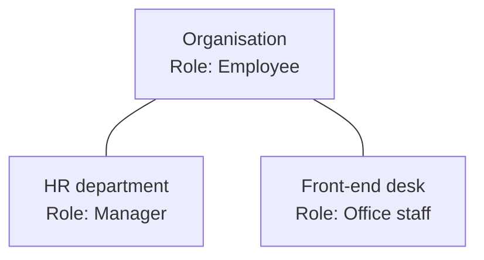

Authorisation determines what authenticated users or systems can do
within the system. Process Focus uses the [Cedar policy
language](https://www.cedarpolicy.com/) to define what is allowed.

Assigning permissions directly to employees is not recommended, as
this makes it hard to reassign work or deal with employees
leaving. Assign permissions to roles, and assign roles to employees.

## Roles

You can create roles at any level of the organisation. Create roles at the
organisational level like the "Employee" role to grant access to
processes available to all employees, such as requesting leave or
creating a support ticket.

Create roles specific to an organisational unit in that unit. For example,
create a "Manager" role in the "HR" department or an "Office staff" role at
the front desk.

## Best Practices

- Follow the principle of least privilege
- Use roles instead of assigning permissions directly to users
- Test authorisation rules thoroughly
