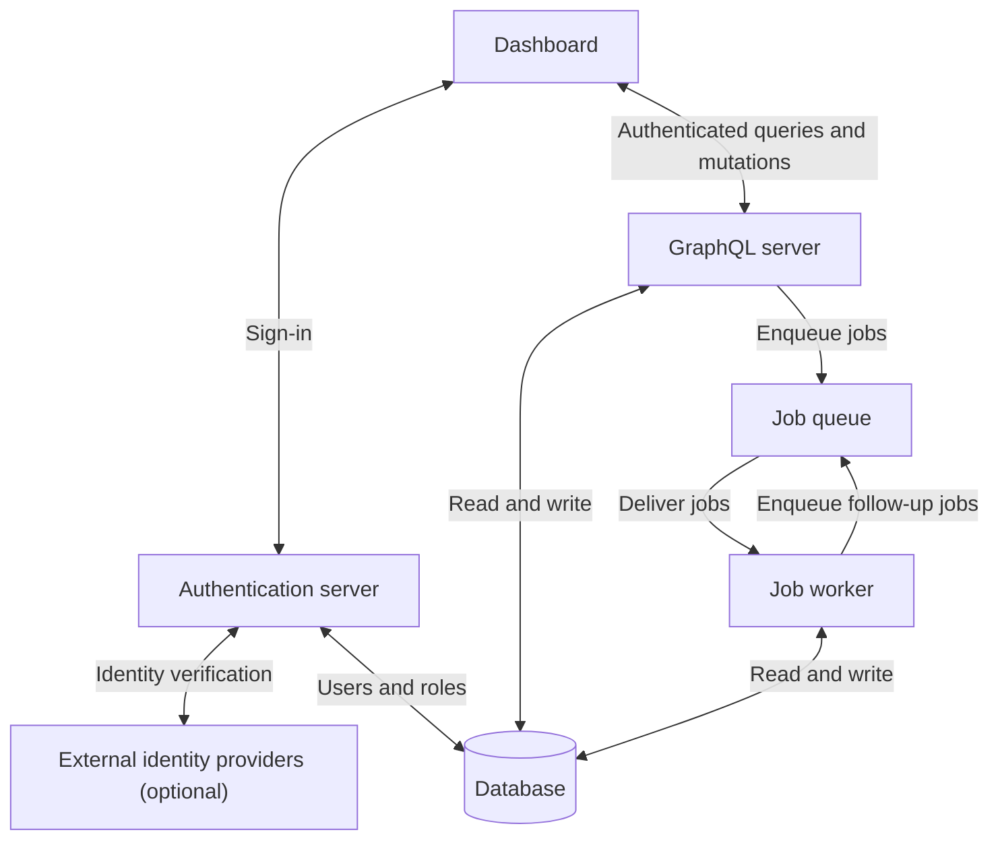

Process Focus implements [framework-defined
infrastructure](https://vercel.com/blog/framework-defined-infrastructure):
you define your application in code, and the framework provides the
runtime services needed to execute it. In Process Focus, that
application is your organisation model, including its business
processes, roles, and forms.

The runtime brings together the Dashboard, authentication, GraphQL API, job
worker, database, and job queue. You can run your model locally for development
and testing, or deploy it to the Process Focus cloud, where the platform
provisions and connects the hosting infrastructure.

The diagram below shows how the runtime components work together:

# Run locally

During development you can run the entire system locally.

Deploying Process Focus to infrastructure maintained by your
organisation is outside the scope of this document.

# Run on Process Focus cloud

Deploying to the Process Focus cloud is easy:

1. Create an account.
2. Create a new project, and pick if it should be deployed in the US, Europe or Australia.
3. Setup an environment like staging or testing.
4. Deploy via the command-line.
